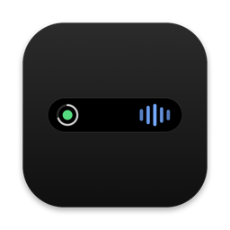
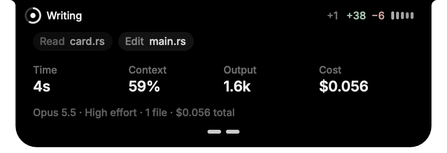
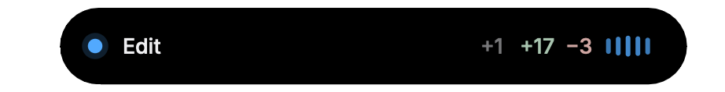

<p align="center">
  
</p>

<h1 align="center">Atoll</h1>

<p align="center">
  <strong>A Dynamic Island for Claude Code, living in your MacBook's notch.</strong>
</p>

<p align="center">
  
  
  <a href="LICENSE"></a>
</p>

<p align="center">
  
</p>

Stop flipping back to the terminal to check if Claude is done. Atoll shows what Claude is doing, what it's changing and what it's costing, right where your eyes already are, and tells you the moment it's your turn.

No plugins, no extension, no account: one setting points Claude Code at a relay on your own machine.

## At a glance

| State            | Island                                                                                      |
| ---------------- | ------------------------------------------------------------------------------------------- |
| **Thinking**     |     |
| **Editing**      |  |
| **Your turn**    |      |
| **Rate limited** |       |
| **External display** |  |

## Features

- **Live activity.** A coloured dot and label for thinking, writing or the tool being called, a waveform that moves with the stream, and a running `+42 −7` count of lines added and removed.
- **Click to expand.** Opens a card with the turn's todo step or recent tool calls, turn time, context used, the turn's output tokens and the total since launch with what each cost, then model, effort and files.
- **Several sessions.** Each Claude Code session gets a pill along the bottom; the lit one owns the numbers. A session quiet for 15 minutes drops off the row.
- **Rate limits.** Shows when the limit lifts, with a ring draining down to it.
- **Permission prompts.** With the optional hook, the island turns amber and says "Needs you".
- **Macs without a notch.** Floats as a small pill under the menu bar and follows it across displays.

## How it works

Atoll runs a small relay on `127.0.0.1` that passes every Claude API call through unchanged and reads the streamed answer as it goes by. The island animates from what it reads, then folds into a compact pill when the turn ends.

## Get it

Requires macOS 13 or later and [Claude Code](https://claude.com/claude-code).

1. **Download** the `.dmg` from the [latest release](https://github.com/purgatoryforcookies/atoll/releases/latest), open it and drag Atoll onto Applications. Or [build it from source](docs/INSTALL.md).
2. **Point Claude Code at it** in `~/.claude/settings.json`, plus the optional permission hook ([INSTALL.md](docs/INSTALL.md#3-point-claude-code-at-atoll)):

   ```json
   "env": { "ANTHROPIC_BASE_URL": "http://127.0.0.1:8788" }
   ```

3. Start a new Claude Code session and watch the notch.

See [INSTALL.md](docs/INSTALL.md) for updating, uninstalling and configuration, and [DEVELOP.md](docs/DEVELOP.md) for running from source, demo scenes and tests.

## Privacy

The relay only listens on `127.0.0.1` and forwards requests upstream as they are, including your API key or login. Atoll reads the streamed responses to animate the island and keeps nothing on disk.

## Credits

- Built on [Rune](https://github.com/anomalyco/rune), the Rust GPU UI framework by [Anomaly](https://github.com/anomalyco), created by Kit Langton with Luke Parker, Dax Raad, James Long and [other contributors](https://github.com/anomalyco/rune/graphs/contributors). Rune is MIT licensed. It draws the island, runs its springs and places the window over the notch.
- Uses [ureq](https://github.com/algesten/ureq) for the upstream connection, [serde_json](https://github.com/serde-rs/json) for parsing the stream and [objc2](https://github.com/madsmtm/objc2) for the macOS screen APIs.

## License

MIT. See [LICENSE](LICENSE).
